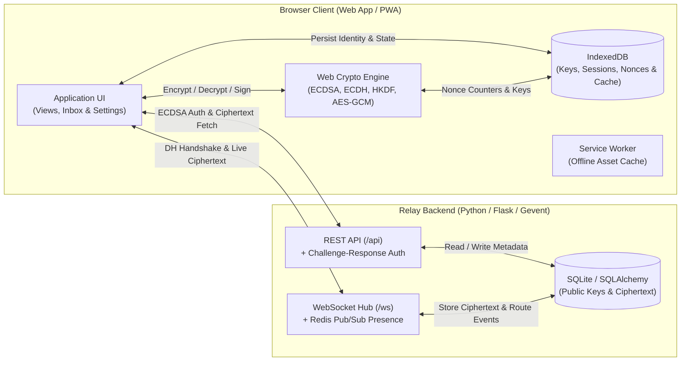

<div align="center">

# Nulla

**An identity-less, end-to-end encrypted communication platform with authenticated ephemeral key exchange and zero-knowledge message relay.**

[](#architecture-overview)
[](#project-structure)
[](#backend-api--database-design)
[](#security--cryptographic-model)

</div>

---

## Overview

**Nulla** is a full-stack, identity-less messaging system built with a zero-dependency Web Crypto API frontend paired with a Python/Flask REST and WebSocket relay backend.

Designed with **anonymity, zero-knowledge transport, and cryptographic identity** as first-class principles, Nulla eliminates usernames, emails, phone numbers, and user profiles. Accounts are defined purely by locally generated `ECDSA` (`P-256`) and `ECDH` (`P-256`) key pairs stored in IndexedDB. All contact handshakes, session key derivations (`HKDF-SHA256`), and message/file encryptions (`AES-256-GCM`) occur **entirely on the client**, ensuring the server never has access to private keys, session keys, or plaintext content.

---

## Key Features

- **Cryptographic Identity (No PII Required):** Generates a random 256-bit base64url contact identifier alongside `ECDSA` signing and `ECDH` key-agreement key pairs using the browser's native Web Crypto API.
- **Authenticated Diffie-Hellman Handshake:** Establishes pairwise sessions via a 3-step WebSocket handshake (`dh_init` -> `dh_response` -> `dh_finish`) signed with `ECDSA-SHA256` over canonical payloads to prevent Man-in-the-Middle (MitM) and replay attacks.
- **Directional Session Keys via HKDF:** Derives asymmetric send (`kSend`) and receive (`kRecv`) `AES-256-GCM` keys plus a deterministic `sessionId` from the shared secret using `HKDF-SHA256` with domain-separated info strings.
- **End-to-End Encrypted Text & File Sharing:** Encrypts both text messages and binary file attachments (including encrypted file metadata) with 96-bit IVs constructed from random 32-bit prefixes and monotonic 64-bit per-direction counters.
- **Trust On First Use (TOFU) & Portable Encrypted Backups:** Pins peer signing public keys locally in IndexedDB to detect key substitution, and exports/imports full account state as `.nulla` backup packages encrypted via `PBKDF2-HMAC-SHA256` (1,000,000 iterations) and `AES-256-GCM` with Additional Authenticated Data (AAD).

---

## Architecture Overview

The system is divided into isolated client storage/crypto layers and a real-time stateless relay server:



### Engineering Highlights

- **Zero-Knowledge Challenge-Response Authentication:** Instead of passwords, `/api/auth/challenge` issues a time-bound cryptographic nonce that the client signs with its private `ECDSA` key; `/api/auth/verify` validates the signature against the registered public JWK and issues a short-lived `HS256` JWT.
- **Multi-Worker WebSocket Presence (`project/backend/app.py`):** Uses `gevent` monkey-patching and `flask-sock` for concurrent HTTP + WebSocket handling, with optional Redis Pub/Sub (`nulla:online_users` and `nulla:ws:user:*`) to route real-time handshakes and messages across multiple Gunicorn worker instances.
- **Non-Blocking UI Decryption Pipeline:** Batches and yields message and binary attachment decryption across animation frames (`requestAnimationFrame`) while caching decrypted payloads in IndexedDB (`decryptedMessages`) for instant chat switching.
- **1:1 Unbundled Build Toolchain (`.pmgr/build.js`):** Mirrors `project/src` into `.pmgr/dist` while resolving `@/` aliases and bundling static dependencies without obfuscating client-side cryptographic code.

---

## Security & Cryptographic Model

| Layer | Implementation | Purpose |
| :--- | :--- | :--- |
| **Account Identity** | 256-bit CSPRNG `userId` + `ECDSA` (`P-256`) + `ECDH` (`P-256`) | Passwordless, identity-less account creation without PII |
| **Server Authentication** | Challenge nonce signed via `ECDSA-SHA256` -> `HS256` JWT | Proves ownership of `userId` without transmitting private keys |
| **Key Exchange** | Authenticated `ECDH` (`P-256`) + canonical payload `ECDSA` signatures | Prevents MitM tampering and binds handshakes to user IDs & nonces |
| **Key Derivation** | `HKDF-SHA256` (`nulla-v1` salt + directional `A->B` / `B->A` info) | Separates `kSend`, `kRecv`, and `sessionId` per conversation |
| **Message & File Encryption** | `AES-256-GCM` with 4-byte random prefix + 8-byte monotonic counter IV | Authenticated encryption preventing nonce reuse and tampering |
| **Peer Verification** | Trust On First Use (TOFU) key pinning in IndexedDB (`trustedKeys`) | Detects unauthorized remote signing key rotation or substitution |
| **Account Backup (`.nulla`)** | `PBKDF2-SHA256` (1,000,000 iterations) + `AES-256-GCM` with AAD | Protects exported identity, session keys, and message cache at rest |

---

## Backend API & Database Design

### REST Endpoints (`/api`)

| Method | Endpoint | Auth | Description |
| :--- | :--- | :--- | :--- |
| `POST` | `/api/register` | None | Registers a `userId` alongside its `signPublicKeyJwk` and `dhPublicKeyJwk` (`200`). |
| `POST` | `/api/auth/challenge` | None | Generates and stores a 30-minute cryptographic challenge `nonce` for `userId` (`200`). |
| `POST` | `/api/auth/verify` | Signature | Verifies the `ECDSA` signature over `nonce` and returns a 24-hour `Bearer` JWT (`200` / `401`). |
| `POST` | `/api/contacts/request` | `Bearer` JWT | Sends a contact request or auto-establishes a chat if a mutual pending request exists (`200`). |
| `GET` | `/api/contacts/requests/incoming` | `Bearer` JWT | Lists pending incoming contact requests for the authenticated user (`200`). |
| `GET` | `/api/contacts/requests/outgoing` | `Bearer` JWT | Lists pending outgoing contact requests sent by the authenticated user (`200`). |
| `POST` | `/api/contacts/requests/<id>/accept` | `Bearer` JWT | Verifies peer online status and triggers the real-time `ECDH` key exchange (`200` / `400`). |
| `POST` | `/api/contacts/requests/<id>/reject` | `Bearer` JWT | Rejects and deletes a pending incoming contact request (`200`). |
| `GET` | `/api/chats` | `Bearer` JWT | Retrieves all established chat channels (`userA::userB`) for the user (`200`). |
| `POST` | `/api/chats/establish` | `Bearer` JWT | Finalizes chat creation and cleans up pending contact requests after `dh_finish` (`200`). |
| `GET` | `/api/chats/<chatId>/messages` | `Bearer` JWT | Fetches paginated encrypted messages and encrypted file metadata for a chat (`200`). |
| `DELETE` | `/api/chats/<chatId>` | `Bearer` JWT | Deletes a chat and all associated ciphertext messages, notifying the peer via WebSocket (`200`). |
| `DELETE` | `/api/account/delete` | `Bearer` JWT | Permanently wipes the user, chats, messages, requests, and nonces from the server (`200`). |

### WebSocket Protocol (`/ws?token=<JWT>`)

- **Contact Lifecycle:** `contact_request`, `contact_request_response`, `contact_request_accepted`, `contact_request_rejected`
- **Authenticated DH Handshake:** `dh_init`, `dh_response`, `dh_finish` (relays ephemeral/static ECDH public keys, nonces, and ECDSA signatures)
- **Messaging & Ephemeral Events:** `send_message`, `new_message`, `message_sent`, `typing`, `chat_deleted`, `user_deleted`

### Database Schema (SQLite / SQLAlchemy)

- **`users`**: `userId (PK)`, `signPublicKeyJwk (TEXT)`, `dhPublicKeyJwk (TEXT)`, `createdAt (DATETIME)`
- **`contact_requests`**: `requestId (PK)`, `fromUserId (FK)`, `toUserId (FK)`, `status (TEXT)`, `createdAt (DATETIME)`, `respondedAt (DATETIME)`
- **`chats`**: `chatId (PK)`, `userA (FK)`, `userB (FK)`, `createdAt (DATETIME)`
- **`messages`**: `msgId (PK)`, `chatId (FK, INDEX)`, `sessionId (TEXT, INDEX)`, `senderId (FK)`, `timestamp (DATETIME, INDEX)`, `ciphertext (TEXT)`, `iv (TEXT)`, `ciphertext_len (INT)`, `isFile (BOOL)`, `encryptedMetadata (TEXT)`, `encryptedMetadataIv (TEXT)`
- **`nonces`**: `nonce (PK)`, `userId (FK, INDEX)`, `expiresAt (BIGINT, INDEX)`, `createdAt (BIGINT)`

---

## Project Structure

```text
Nulla/
├── .gitignore                                              # Ignored build artifacts, virtualenvs, local DBs, and .nulla backups
├── README.md                                               # Project documentation and architectural reference
├── .pmgr/                                                  # Build and bundling toolchain (Bun / Vite / esbuild)
│   ├── build.js                                            # 1:1 source mirror builder and static dependency bundler
│   ├── bun.lock                                            # Deterministic Bun dependency lockfile
│   ├── package.json                                        # Frontend build scripts and package dependencies
│   └── vite.config.js                                      # Vite dev server and asset bundling configuration
└── project/                                                # Core application workspace
    ├── backend/                                            # Python Flask REST & WebSocket relay backend
    │   ├── app.py                                          # Flask app, SQLAlchemy models, REST endpoints, and /ws hub
    │   └── requirements.txt                                # Python backend dependencies (Flask, Gevent, Cryptography, PyJWT)
    └── src/                                                # Client web application source code (PWA)
        ├── css/                                            # Application stylesheets
        │   └── main.css                                    # Dark/light theme tokens, layout grid, inbox, and modal styles
        ├── html/                                           # Application markup
        │   └── index.html                                  # Single-page app shell (landing, home, contacts, inbox, settings)
        ├── icons/                                          # PWA and browser branding assets
        │   ├── apple-touch-icon.png                        # iOS home screen touch icon
        │   ├── favicon-96x96.png                           # Standard 96x96 browser tab favicon
        │   ├── favicon.ico                                 # Legacy multi-resolution ICO favicon
        │   ├── favicon.svg                                 # Scalable vector browser favicon
        │   ├── site.webmanifest                            # Web app manifest metadata for icon discovery
        │   ├── web-app-manifest-192x192.png                # 192x192 Android / PWA install icon
        │   └── web-app-manifest-512x512.png                # 512x512 PWA splash screen and store icon
        ├── js/                                             # Modular client-side application logic
        │   ├── api.js                                      # REST client with automatic ECDSA challenge-response JWT auth
        │   ├── app.js                                      # UI view controller, DH handshake orchestrator, and chat renderer
        │   ├── crypto.js                                   # Web Crypto API wrapper (ECDSA, ECDH, HKDF, AES-GCM, PBKDF2)
        │   ├── storage.js                                  # IndexedDB persistence layer and .nulla backup import/export
        │   ├── sw.js                                       # Service Worker for offline PWA shell caching
        │   └── ws.js                                       # WebSocket client with exponential backoff reconnection
        └── manifest/                                       # Progressive Web App configuration
            └── manifest.json                               # Standalone display rules, theme colors, and PWA icon mappings
```
